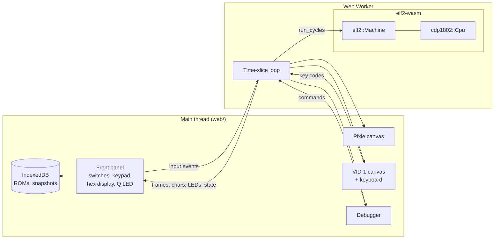
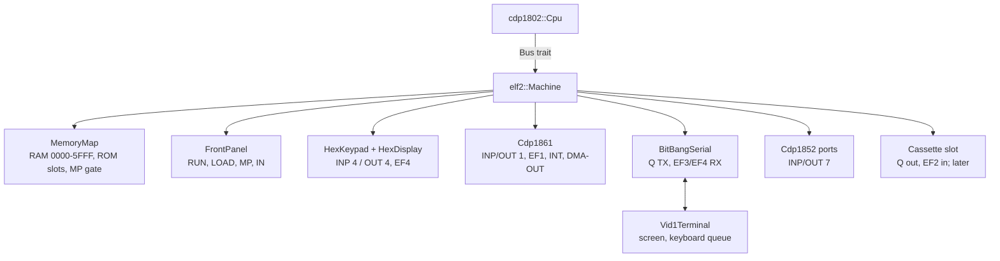

# Design: Netronics Elf II browser emulator

## Overview

The emulator is a Rust workspace with four crates and a static web front end:

- `cdp1802`: the CPU core and disassembler. `no_std`, no dependencies on the machine.
- `elf2`: the machine. Memory map, front panel, keypad and hex display, CDP1861,
  Giant Board serial and parallel ports, VID-1 terminal model, cassette slot.
- `elf2-wasm`: `wasm-bindgen` wrapper exposing the machine to JavaScript.
- `elf2-cli`: native runner for tests and for running user ROMs from a shell
  (serial terminal on stdin/stdout).
- `web/`: HTML, CSS and plain ES-module JavaScript. No npm toolchain; the only
  build step is `wasm-pack build --target web`.

The machine runs in a Web Worker. The UI thread draws the front panel, the Pixie
screen and the VID-1 screen, and forwards input to the worker.

Requirement numbers below refer to `requirements.md`.

## Architecture



Inside `Machine`, the CPU talks to one `Bus` implementation (the machine itself),
which routes each operation to the memory map and the peripherals:



## Repository layout

```
emulator/
  Cargo.toml                 workspace
  crates/
    cdp1802/                 CPU core, disassembler, opcode tests
    elf2/                    machine and peripherals, machine tests
    elf2-wasm/               wasm-bindgen API
    elf2-cli/                native runner
  web/
    index.html
    css/
    js/                      main.js, worker.js, panel.js, pixie.js,
                             terminal.js, debugger.js, storage.js, files.js
    pkg/                     wasm-pack output (generated, not committed)
  tests/programs/            project-written test programs (source + .hex)
.github/workflows/pages.yml  build and deploy to GitHub Pages
```

## CPU core (`cdp1802`)

### State

```rust
pub struct Cpu {
    pub r: [u16; 16],
    pub d: u8, pub df: bool,
    pub p: u8, pub x: u8, pub t: u8,
    pub n: u8, pub i: u8,
    pub ie: bool, pub q: bool,
    pub state: CpuState,      // Running, Idle (IDL), Reset, Load, Pause
    pub cycles: u64,          // machine cycles since power-on
}
```

### Bus trait

As sketched in `notes.md`, with two changes: explicit DMA methods, and a `tick`
so peripherals advance with every machine cycle the CPU consumes.

```rust
pub trait Bus {
    fn read(&mut self, addr: u16) -> u8;
    fn write(&mut self, addr: u16, val: u8);       // MP gating happens in the machine
    fn out(&mut self, port: u8, val: u8);          // port 1..=7; val = M(R(X))
    fn inp(&mut self, port: u8) -> u8;             // result goes to M(R(X)) and D
    fn ef(&self, line: u8) -> bool;                // 1..=4, true = asserted (B1..B4 branch)
    fn set_q(&mut self, q: bool);
    fn dma_in(&mut self) -> u8;                    // byte supplied by the peripheral
    fn dma_out(&mut self, val: u8);                // byte delivered to the peripheral
    fn signals(&self) -> Signals;                  // dma_in, dma_out, int levels
    fn tick(&mut self, cycles: u32);               // advance peripherals
    fn interrupt_ack(&mut self) {}                 // S3 cycle (SC1/SC0 = 11); 1861 aligns to it
}
```

### Execution model

`Cpu::step(&mut self, bus)` does one unit of work and returns the machine cycles it
used:

1. If a DMA-IN request is active: one S2 cycle. `M(R0) = bus.dma_in()`, R0 += 1, 1 cycle.
2. Else if DMA-OUT is active: one S2 cycle. `bus.dma_out(M(R0))`, R0 += 1, 1 cycle.
3. Else if INT is active and IE = 1: one S3 cycle. `T = (X << 4) | P`, X = 2, P = 1, IE = 0, 1 cycle.
4. Else if the CPU is idle (IDL), one cycle passes.
5. Else fetch and execute one instruction: 2 cycles, or 3 for long branches,
   long skips and NOP (C4).

After every unit, `bus.tick(cycles)` advances the peripherals. Requests are
therefore sampled only at instruction boundaries, as on the real chip. This
reproduces the 1861 behaviour where a 3-cycle instruction delays a DMA burst
(requirement 6.7).

Requirement 2.4 (priority DMA-IN > DMA-OUT > INT) is the order of the checks.
IDL exits on DMA or interrupt.

### Instruction set

All 256 opcodes are decoded by a `match` on the full byte (no lookup tables of
closures), which compiles to a jump table. Opcode 68 is treated as the 1802's
undefined/INP 0 behaviour, not the 1804 extension prefix. The DF rules for ADD,
ADC, SD, SDB, SM, SMB and shifts follow the RCA CDP1802 user manual.

### Disassembler

`disasm(bytes, addr) -> (text, len)` with RCA mnemonics. Used by the debugger and
by test failure messages.

## Machine (`elf2`)

### Configuration

```rust
pub struct Config {
    pub clock_hz: u32,                 // default 1_789_773
    pub ram_size: u32,                 // default 24 * 1024
    pub unmapped_read: u8,             // default 0xFF
    pub roms: Vec<RomSlot>,            // { name, sha256, base, bytes }
    pub start_at_f000: bool,           // Giant Board start-up jumper (req 3.8)
    pub pixie: Option<PixieConfig>,    // { on_is_inp: bool }  (req 6.6)
    pub serial: Option<SerialConfig>,  // see below
    pub vid1: Vid1Config,              // columns 64 | 32, codes: Vec<ControlCode>
    pub parallel_1852: bool,
    pub parallel_sr_to_int: bool,      // jumper: CDP1852 input service request -> /INT
    pub cassette: bool,                // false in v1
}
pub struct SerialConfig {
    pub rx_ef: u8,                     // 3 (default) or 4
    pub tx_inverted: bool, pub rx_inverted: bool,
    pub baud: u32, pub data_bits: u8, pub parity: Parity, pub stop_bits: u8,
    pub paste_gap_ms: u32,             // default 40: lets a half-duplex monitor finish echoing
    pub paste_cr_gap_ms: u32,          // default 200
}
```

`Config` is serialisable (serde, JSON) so the front end can store it and the CLI
can read it from a file. ROM bytes are not stored in the config, only name, base
address and SHA-256.

### Memory map and front panel

- RAM covers `0..ram_size`. ROM slots overlay RAM where they overlap. Other
  addresses read `unmapped_read`; writes to them are ignored.
- `MP` blocks every write (CPU and DMA-IN) while on (requirement 3.7).
- `FrontPanel` holds RUN, LOAD, MP and IN and drives the CPU state:

| RUN | LOAD | CPU state |
|---|---|---|
| off | off | `Reset`: registers cleared per requirement 3.5, peripherals reset. |
| off | on | `Load`: CPU does not fetch. Each IN press raises a single DMA-IN request. |
| on | off | `Running` from 0000 (or F000 if `start_at_f000`). |
| on | on | `Pause`: the CPU is frozen; each `step` is one machine cycle of elapsed time so peripherals keep running. |

The F000 start is modelled as the Giant Board does it: on leaving Reset with the
jumper set, the machine forces a long branch to F000 by feeding `C0 F0 00` to the
first fetches. The exact circuit is a [verify] item; this option keeps the
behaviour isolated in one place.

### Hex keypad and display

- `HexKeypad` keeps a two-digit shift latch. Each key press shifts in one nibble.
- `INP 4` returns the latch. IN asserts EF4 while held in Run mode.
- In Load mode, IN raises one DMA-IN; `dma_in()` returns the latch, the display
  shows it, and the write goes through the MP gate.
- `HexDisplay` latches `OUT 4` and every DMA-IN byte.

### CDP1861 (`Cdp1861`)

A counter of machine cycles within a frame: `line = cycle / 14`, `col = cycle % 14`,
262 lines per frame. When the display is on:

- Lines 0..79: blanking. INT is asserted for 28 cycles about two lines before the
  first active line (80). On the CPU's interrupt-acknowledge cycle the chip aligns its
  counter so the first DMA burst starts 29 cycles later, as the real chip does using
  the state-code lines.
- 128 active lines. At `col == 0` the chip asserts DMA-OUT for 8 cycles. Each
  `dma_out(byte)` call stores the byte into the current line buffer.
- EF1 is asserted for the 4 lines before the display and the last 4 active lines
  (lines 76-79 and 204-207; [verify]; constants in `pixie.rs`).
- At the end of the frame, the 64x128 bitmap (1 KB) is published as a frame event.

DMA-OUT is a level: if the CPU is in a 3-cycle instruction when the burst begins,
the burst starts late and the pixels shift, as on hardware. When the display is
off the chip asserts nothing and only counts cycles.

The on/off port direction comes from `PixieConfig::on_is_inp` (requirement 6.6).

### Bit-banged serial (`BitBangSerial`) and VID-1 (`Vid1Terminal`)

The two ends of the serial cable are modelled separately so each can be tested
alone.

**Transmit (Elf II to VID-1).** Every Q change is recorded with its machine-cycle
time. A UART receiver state machine works on these timestamps:

1. Wait for the line to go from idle to start level.
2. Sample each data bit at the centre of its bit period
   (`start + (k + 1.5) * cycles_per_bit`).
3. Check the stop bit; on a framing error, flag the character and resynchronise on
   the next start edge.

`cycles_per_bit = clock_hz / 8 / baud`. Sampling at bit centres and resynchronising
on every start bit tolerates the jitter of software delay loops (requirement 7.6).

**Receive (VID-1 to Elf II).** Characters typed in the terminal go into a queue.
A UART transmitter turns the head of the queue into a schedule of line levels at
machine-cycle times. `ef(rx_ef)` returns the current level, after the polarity
option. Paste uses the same queue with a configurable gap between characters and
after CR (requirement 8.10).

**EF4 sharing.** If `rx_ef == 4`, EF4 is the OR of the IN button and the serial
RX asserted level (requirement 5.2).

**VID-1 screen.** A 1 KB buffer of 16 lines x 64 (or 32) columns and a cursor.
Printable characters write at the cursor and advance; control codes are looked up
in a table that defaults to requirement 8.5 and can be edited for the [verify]
codes (cursor up/down/right/home, erase EOL/EOS). Unknown codes are ignored. The
terminal never echoes locally.

### CDP1852 parallel ports and cassette slot

- `Cdp1852` implements INP 7 / OUT 7 latches and a service-request output that
  can be routed to INT. Unconnected by default.
- `Cassette` is a peripheral slot with `q_changed(cycle, level)` and an EF2 source.
  In v1 it is a stub that reads idle. The later WAV feature fills it in using the
  `cassette-loader` format notes.

### Event output

`Machine::run(cycles)` runs until the budget is used or a breakpoint is hit, and
collects events into a reusable buffer:

```rust
pub enum Event {
    PixieFrame,                 // bitmap available via frame_ptr()
    TermChar(u8),               // character decoded from TX, already applied to the VID-1 model
    TermFramingError,
    HexDisplay(u8),
    Q(bool),                    // coalesced: only the last level per run is reported
    Breakpoint(u16),
    Halted,                     // IDL with no pending requests
}
```

## Wasm API (`elf2-wasm`)

```rust
#[wasm_bindgen]
impl Emulator {
    pub fn new(config_json: &str) -> Result<Emulator, JsError>;
    pub fn load_rom(&mut self, name: &str, base: u16, bytes: &[u8]);
    pub fn load_bin(&mut self, base: u16, bytes: &[u8]);
    pub fn load_hex(&mut self, text: &str) -> Result<(), JsError>;
    pub fn save_bin(&self, start: u16, end: u16) -> Vec<u8>;
    pub fn save_hex(&self, start: u16, end: u16) -> String;

    pub fn run(&mut self, cycles: u32) -> u32;        // returns event count
    pub fn events(&self) -> Vec<u32>;                 // packed events
    pub fn pixie_frame(&self) -> *const u8;           // 1024 bytes in wasm memory
    pub fn vid1_screen(&self) -> *const u8;           // 1024 bytes + cursor via vid1_cursor()

    pub fn set_switch(&mut self, sw: u8, on: bool);   // RUN, LOAD, MP
    pub fn press_in(&mut self, down: bool);
    pub fn hex_key(&mut self, nibble: u8);
    pub fn term_key(&mut self, code: u8);
    pub fn term_paste(&mut self, text: &str);
    pub fn force_ef(&mut self, line: u8, state: i8);  // -1 release, 0/1 force

    pub fn state_json(&self) -> String;               // registers, flags, disasm at PC
    pub fn peek(&self, addr: u16, len: u16) -> Vec<u8>;
    pub fn poke(&mut self, addr: u16, bytes: &[u8]);
    pub fn step(&mut self) -> u32;
    pub fn set_breakpoint(&mut self, addr: u16, on: bool);
    pub fn snapshot(&self) -> Vec<u8>;                // magic + version + JSON state + 64K image
    pub fn restore(&mut self, data: &[u8]) -> Result<(), JsError>;
}
```

Bitmaps are read straight from wasm memory through typed-array views, so no copy
is made per frame.

As built (task 13) the API also has: `config_json`, `cycles_per_second`,
`missing_roms_json`, `boot_f000` (keys in `C0 F0 00` at 0000), `stopped_at`,
`hex_display`, `q`, `ef_bits`, `term_pending`, `pixie_on`, `vid1_columns`,
`vid1_cursor` (`row * 256 + col`), `disasm_json` and `set_register`. The frame and
screen accessors are `pixie_frame_ptr` / `vid1_screen_ptr` (addresses in wasm memory).
Events are packed as `(kind << 24) | value` with kinds 1 PixieFrame, 2 TermChar,
3 TermFramingError, 4 HexDisplay, 5 Q, 6 Breakpoint, 7 Halted. Release build: about
240 KB of Wasm plus 21 KB of JavaScript glue.

## Front end (`web/`)

### Threads and timing

- `worker.js` owns the `Emulator`. It runs a loop driven by `setTimeout(0)` and
  `performance.now()`: each pass computes how many machine cycles should have run
  since the last pass (`elapsed * clock_hz / 8`), caps it at 50 ms worth to avoid
  spirals after the tab was hidden, calls `run`, and posts the results.
- Video and screen bitmaps are copied once per animation frame into a transferable
  `ArrayBuffer` and posted to the main thread. GitHub Pages cannot send the
  COOP/COEP headers that `SharedArrayBuffer` needs, so the design does not use it.
- "Max speed" ignores wall time and runs fixed large slices.
- The main thread draws with `requestAnimationFrame`. Input events are posted to
  the worker immediately.

Requirement 12.2 holds because all timing is in emulated machine cycles; wall time
only decides how many cycles to run.

### Panels

- **Front panel**: RUN, LOAD, MP latching switches, IN button, 16 hex keys,
  two seven-segment digits, Q LED, EF1-EF4 indicators.
- **Pixie screen**: canvas 64x128 logical pixels, integer scaling, optional
  scanline style.
- **VID-1 screen**: canvas of 16 x 64 (or 32) character cells with a bitmap font
  and cursor; captures keys when focused.
- **Debugger**: registers with P and X marked, D, DF, Q, IE, EF lines, disassembly
  around PC, memory editor, breakpoints, single step, serial line monitor.
- **Files**: load `.bin` / `.hex` at an address, save a range, drag and drop,
  ROM manager.

Keyboard focus decides the target: the VID-1 panel gets ASCII, the front panel gets
hex keys and switch shortcuts (requirement 8.11).

### Storage

- **ROMs**: IndexedDB store `roms` keyed by SHA-256, with name, size and bytes.
  On start, the configuration's ROM list is resolved against this store; missing
  ROMs produce a message naming the ROM and its expected checksum (requirement 13.3).
- **Configuration**: `localStorage`, JSON.
- **Snapshots**: IndexedDB store `snapshots`. Auto-saved on page hide, restored on
  load (requirement 10.4).
- **URL preload**: `?load=<file>@<addr>` fetches a program from the site's
  `programs/` folder, which only holds project-written programs.

## Build and deployment

`.github/workflows/pages.yml`:

1. Install Rust stable with the `wasm32-unknown-unknown` target and `wasm-pack`.
2. `cargo test --workspace` (native).
3. `wasm-pack build crates/elf2-wasm --target web --release --out-dir ../../web/pkg`.
4. Upload `web/` as the Pages artifact and deploy.

`wasm-opt -Oz` (from wasm-pack) keeps the Wasm under about 200 KB, well inside the
2 MB budget (requirement 1.5).

## Error handling

| Situation | Behaviour |
|---|---|
| Invalid Intel HEX (bad checksum, bad record) | Load rejected, message with line number; memory unchanged. |
| File larger than the target region | Load rejected with the sizes. |
| ROM missing from storage | Machine starts without it; banner names the ROM and checksum. |
| Snapshot from an incompatible version | Ignored with a message; fresh machine started. |
| Serial framing error | Character dropped, counted in the serial monitor. |
| Worker crash (panic in wasm) | Panic hook posts the message; UI offers reset. |

## Testing strategy

### Correctness properties

These are checked with property-based tests (`proptest`) in the native build.

1. **Cycle accounting.** For every opcode and every CPU state, `step` returns 2,
   except C0-CF long branch/skip and C4 which return 3, and DMA/INT/idle units
   which return 1. `cpu.cycles` equals the sum of returned values.
2. **Arithmetic.** For all D, M(R(X)) and DF, ADD/ADC/SD/SDB/SM/SMB and the
   immediate forms match a reference model written from the RCA manual's
   definitions (9-bit arithmetic).
3. **Branch semantics.** For all EF states, Q, DF and D, short and long branches
   and skips take the documented path; short branches stay in the current page.
4. **DMA.** Each DMA-IN or DMA-OUT unit transfers exactly one byte at M(R0) and
   increments R0 by one; no other register changes.
5. **Interrupt entry and RET/DIS.** INT with IE = 1 saves X and P to T, sets X = 2,
   P = 1, IE = 0; RET and DIS restore X and P from M(R(X)) and set IE to 1 or 0.
6. **Serial round trip.** For any byte, baud setting and polarity, the RX scheduler
   followed by a software-style receive loop recovers the byte; and a TX bit
   pattern with each bit edge displaced by up to ±10% of a bit, plus a ±3% rate
   error, decodes to the original byte. (Together they must stay under half a bit
   over an 11-bit frame, the limit for any receiver that samples at bit centres.)
7. **Intel HEX round trip.** `load_hex(save_hex(a, b))` restores the same bytes for
   any range.
8. **Keypad latch.** Any sequence of key presses leaves the last two nibbles in the
   latch, most recent in the low nibble.
9. **Memory protect.** With MP on, no sequence of CPU writes or DMA-IN cycles
   changes RAM.

### Unit and integration tests

- **Opcode tests**: one table-driven test per opcode family with hand-written
  before/after states.
- **CDP1861**: a project-written 64x32 display program; the test checks INT is held
  28 cycles, exactly 128 DMA bursts of 8 bytes per frame, EF1 timing, and the
  rendered bitmap.
- **Serial**: a project-written echo program (bit-banged on Q / EF3 at 300 baud);
  the test types a string into the VID-1 model and checks the screen.
- **Front panel**: load bytes through LOAD + IN, verify with MP on, run, and check
  the hex display.
- **Owner's ROMs** (not in CI): `elf2-cli --rom giantboard.hex@F000` runs the Giant
  Board monitor with the terminal on stdin/stdout, to confirm serial settings and
  the [verify] items on real software.

## Open design points

1. The CDP1861 on/off port direction and EF1 lines (requirements 6.5, 6.6) are
   constants in one module, set once the datasheet is checked.
2. VID-1 control codes beyond requirement 8.5 are a data table, edited when the
   manual is available.
3. Giant Board F000 start-up and serial polarity defaults are config values, set
   after running the owner's monitor ROM under `elf2-cli`.
