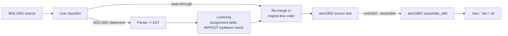

# Design: MOL1802

Requirement numbers below refer to `requirements.md`.

## Overview

MOL1802 is a new crate, `mol1802`, alongside `asm1802` in the existing
`emulator` workspace. It is a straight-line text-to-text transpiler: classify
each input line as either a pass-through line or a MOL1802 statement, parse
the MOL1802 statements into a small AST, lower each AST node to the real
`asm1802` instruction(s) that realize it (Requirement 3/4's tables), and
re-merge everything back into one assembly-text output in original order. It
depends on `asm1802` as a normal (not dev-only) dependency, so the CLI can
optionally assemble its own output in one step, and so integration tests can
assert the *generated* assembly actually assembles (Requirement 1.5) without
shelling out.



## Repository layout

```
emulator/
  crates/
    mol1802/
      Cargo.toml            depends on asm1802 (lib)
      src/
        lib.rs               pub fn transpile(...) -> Result<String, Vec<Diagnostic>>
        ast.rs                Statement, Operand, Condition, BranchLength
        classify.rs           pass-through vs. MOL1802 statement, per line
        parser.rs             line text -> Statement
        lower.rs               Statement -> Vec<EmittedLine>; the
                               register-to-register scratch mechanism
        xtrack.rs              one-line-lookback "is the previous emitted
                               line exactly `SEX Rn`" check, shared by
                               INP/OUT (Requirement 4.4, errors if absent)
                               and PUSH/POP/arithmetic (Requirement 7.3/9.1,
                               inserts if absent, never errors)
        diagnostic.rs          shared with asm1802's Diagnostic shape
        main.rs                CLI
      tests.rs                 unit tests (one per table row) +
                               integration tests (transpile then assemble)
```

`asm1802`'s existing `Diagnostic { file, line, message }` shape is reused
as-is (imported, not redefined), so MOL1802 errors print identically to
`asm1802` errors and any editor/problem-matcher integration already built for
one works for both.

## Pipeline stages

### 1. Line classifier (`classify.rs`)

Per Requirement 1.2, a line is a MOL1802 statement only if, after stripping an
optional leading label (`NAME:` or `NAME`, same rule `asm1802` already uses
for label recognition, re-implemented minimally here rather than imported,
since `asm1802`'s label parsing is private), the remainder matches one of:

- Contains a top-level `:` (a chain: `A:B`, `A:B:C`, ...).
- Starts with a condition token (`EF1=0?`, `D<>0?`, etc. -- Requirement 5.1's
  table, left-hand side) followed by `/` or `//`.
- Is exactly `/LABEL` or `//LABEL` (bare branch).

A `STK` push/pop (`list:STK` / `STK:list`) is just a chain by this rule too
-- the comma-separated `list` doesn't change that there's still exactly one
top-level `:`.

Everything else -- including `CALL`, `RETURN`/`RETN` (Requirement 6.1), every
directive, and plain `asm1802` instruction lines a developer wrote directly
(including every `SEX Rn` line that sets up an upcoming `INP`/`OUT`) -- is a
pass-through line, copied verbatim with its own comment intact.

This is intentionally a *shallow* syntactic check, not a semantic one: a
line that looks like a chain but isn't valid MOL1802 (e.g. a typo) is handed
to the parser, which then produces a proper diagnostic (Requirement 1.4)
rather than being silently passed through as broken `asm1802` text.

### 2. AST (`ast.rs`)

```rust
enum Operand {
    D,
    Df,
    Reg(RegRef),                    // Rn
    RegHalf(RegRef, Half),          // Rn.0 / Rn.1 / Rn' (Half::Low/High)
    Mem(RegRef, Adjust),            // (Rn), (Rn++), (++Rn), (Rn--), (--Rn)
    Port(Expr),                     // PORT(n)
    Ef(u8),                         // EF1..EF4
    Q,
    Ei,                             // only valid as chain tail: 1:EI / 0:EI
    Imm(Expr),                      // opaque text, handed to asm1802 verbatim
}
enum Adjust { None, PostInc, PostDec, PreInc, PreDec }

enum Condition { EfEq(u8, bool), DZero(bool), DfEq(bool), QEq(bool) }
enum BranchLength { Short, Long }

enum StackElement { D, Reg(RegRef) }        // the only things valid in a STK list
enum StackDirection { Push, Pop }            // list:STK vs STK:list

enum Statement {
    Chain(Vec<Operand>),                                   // A:B, or a
                                                             // fan-out A:B:C:...
                                                             // (Requirement 3.5)
    Branch { cond: Option<Condition>, len: BranchLength, target: String },
    Stack { elements: Vec<StackElement>, direction: StackDirection },
                                                             // list:STK / STK:list
}
```

`Expr` is just the source substring: per the "pass numeric/label expressions
through unevaluated" decision, MOL1802 never parses arithmetic itself.

Note what's *gone* from the previous revision of this design: there is no
`XIndirect` operand variant. Retiring `(RX)` (Decisions, `requirements.md`)
means the only thing a chain with more than two elements can mean is a
fan-out (Requirement 3.5) -- the same source written into several
destinations -- not a pipeline or an `(RX)`-style indirection.

### 3. Parser (`parser.rs`)

One MOL1802 statement per line (no multi-line statements in v1). A chain
splits on every top-level `:`; exactly two elements is the ordinary
register-transfer form, and more than two is a fan-out (Requirement 3.5),
both producing the same `Statement::Chain(Vec<Operand>)`, just with lowering
telling them apart by length. Each operand token is matched against the
Requirement 2
grammar in a fixed order (most specific first: `(Rn...)` forms, then
`PORT(...)`, then `EF1`-`EF4`/`Q`/`D`/`DF`/`EI` literal keywords, then
`Rn[.0/.1/']`, then "anything else is an `Imm` expression"). Unrecognized
operand shapes produce a diagnostic naming the token and the line
(Requirement 1.4), not a guess.

### 4. Lowering (`lower.rs`)

For `Statement::Chain(ops)` with exactly two elements, `[a, b]`:

1. **`PORT(n)` special case first** (Requirement 4): if either `a` or `b` is
   `Port(n)`, the *other* side must be exactly `D` (4.1/4.2), or it's the 4.5
   error. If it is `D`, emit the `xtrack` lookback check (section 5 below) --
   error if the immediately preceding emitted line isn't `SEX Rn` for some
   `Rn` -- then emit `INP n` (if `a` was `Port`) or `OUT n` (if `b` was
   `Port`). This is the *only* place lowering can produce a Requirement 4.4
   "missing `SEX`" error.
2. **Otherwise, the Requirement 3 table**: a `match` over `(Operand, Operand)`
   shape (not a literal hash table, since several rows need the adjustment
   kind inspected). All eight `(Rn...)` adjustment combinations resolve to
   ordinary direct-register instructions here -- none of them touch `X`, so
   none of them go through the `xtrack` check at all. That check exists
   solely for `PORT(n)` chains now.

For `Statement::Chain(ops)` with more than two elements (Requirement 3.5,
the fan-out form): none of the above applies -- `PORT(n)`, the
constant-arithmetic sugar, and the register-to-register-arithmetic sugar are
all exclusively two-operand forms. Instead, `ops[0]` is lowered via whichever
`(X, D)` row of the Requirement 3 table applies to it (`D` itself needing
nothing, an immediate needing `LDI`, `Rn.0`/`Rn.1` needing `GLO`/`GHI`, or
`(Rn...)` needing the matching `LDN`/`LDA`/`INC`/`DEC` sequence), and then
every `ops[1..]` is lowered via the matching `(D, X)` row in turn (`PLO`,
`PHI`, or the matching `STR`-based sequence) -- reusing both halves of the
same table, never duplicating them. A full register or any of
`PORT(n)`/`DF`/`Q`/`EI` in `ops[1..]` (or `ops[0]`, for the ones that could
only ever be a destination) is an error, not a guess.

`Statement::Branch` lowers directly per Requirement 5's table.
`Statement::Stack` lowers per Requirement 7: each list element pushed or
popped left to right, with **no** `xtrack` involvement at all -- `STK` is
the one piece of `X`-sensitive sugar that neither checks for nor inserts a
`SEX`, trusting the developer completely (Requirement 7.5).

### 5. The `xtrack` one-line lookback (`xtrack.rs`)

One small helper, used in two modes:

```rust
/// Does the immediately preceding *emitted output line* read exactly
/// `SEX <reg>`? Looks back exactly one line; never further.
fn preceding_sex(output_so_far: &[EmittedLine]) -> Option<RegRef>;
```

- **`INP`/`OUT` (Requirement 4.4)**: if `preceding_sex(...)` doesn't return
  `Some(reg)`, it's an error. The register `reg` it finds is whatever the
  developer wrote -- MOL1802 doesn't care which one, only that one is there.
- **Register-to-register arithmetic (9.1)**: if `preceding_sex(...) !=
  Some(R6)`, insert `SEX R6`; otherwise insert nothing. Never an error,
  since `R6` is fixed by the sugar itself, not supplied by the developer.
- **`STK` (Requirement 7.5) uses neither mode.** It's the sole exception:
  no lookback, no check, no insertion. `X` being `R2` is entirely the
  developer's responsibility.

This single helper, with two call sites interpreting its result differently
(error vs. auto-insert), replaces what earlier design notes described as a
more general `(RX)` mechanism -- there is no `(RX)` left to generalize over
once `INP`/`OUT` are the only consumers of `X` the developer writes directly.

### 6. Register-to-register arithmetic (Requirement 9)

Resolving what Requirement 9.3 deferred to design:

- **Reserved register: `R6`.** The first register not already claimed by a
  fixed role (`R1`-`R5`) or by convention reserved for DMA on real Elf II
  hardware (`R0` -- several transcribed listings in this project use `R0`
  that way, e.g. the Lander display interrupt handler). `R6` is used for
  nothing else by MOL1802.
- **Scratch byte placement: end of output.** A single `MOL1802_SCRATCH: DB 0`
  is appended after all pass-through/lowered code. A later `MOL SCRATCH AT
  addr` directive could override this if a program's memory layout needs the
  byte somewhere specific -- out of scope for now.
- **One-time init, auto-prepended.** If any register-to-register arithmetic
  statement appears anywhere in the source, the compiler prepends
  `LDI HIGH(MOL1802_SCRATCH)` / `PHI R6` / `LDI LOW(MOL1802_SCRATCH)` /
  `PLO R6` to the very top of the generated output. This assumes the
  program's real entry point is the first bytes of the file -- true of every
  sample program in this project. If no such statement appears, neither the
  init block nor the scratch byte is emitted at all.
- **The add/subtract sequence itself**, e.g. `Rm.0 + Rn.0 : Rn.0`:
  ```
  SEX R6          ; (xtrack: only if not already)
  GLO Rm          ; get Rm.0 into D
  STR R6          ; stage it via the scratch byte (R6 points at MOL1802_SCRATCH)
  GLO Rn          ; get Rn.0 into D
  ADD             ; D += M(R6)
  PLO Rn          ; store result
  ```
  Subtract uses `SM` in place of `ADD` (and swaps which operand is staged,
  since `SM` computes `D - M(R(X))`, not the reverse). The 16-bit form
  (Requirement 9.4) repeats the pattern for `.1`, using `ADC`/`SMB` so `DF`
  carries from the low-byte step, matching hand-written 1802 code exactly.

### 7. Re-merge and output

Lines are processed and emitted in source order; nothing is reordered except
the Requirement 9 init block (always first) and the scratch byte declaration
(always last). Comments attach to the *last* emitted line of a statement
(Requirement 10.1); multi-line expansions get a leading `; <original
statement text>` comment on their first emitted line when they expand to more
than one instruction (Requirement 10.2), so generated output is traceable
back to its source line without annotating every single instruction.

### 8. CLI (`main.rs`)

Mirrors `asm1802`'s CLI shape for familiarity:

```
mol1802 <source.mol>
  -o <file>            write the transpiled asm1802 source (default:
                       <source> with .asm)
  --assemble           also assemble the output (via asm1802::assemble_with)
  -o <file.hex>        with --assemble, the assembled output path
  -l, --listing        with --assemble, also write a listing
  --max-errors N        passed through to asm1802 when --assemble is used
```

## Error handling

Every diagnostic (classifier rejecting a malformed-looking chain, parser
rejecting an unknown operand, lowering rejecting a `PORT(n)` chain missing
its `SEX` or missing its `D`) carries the 1-based source line number and a
message, using `asm1802`'s existing `Diagnostic { file, line, message }`
type. `--assemble` runs then surface any *subsequent* `asm1802` diagnostics
the same way, so a user sees one consistent error format regardless of which
stage caught the problem.

## Testing strategy

Matching how this project has verified every other assembler-adjacent change
(by actually assembling, not just trusting the translation):

1. **Table-driven unit tests**: one test per row of Requirement 3's table and
   Requirement 4/5/7's `INP`/`OUT`/branch/stack rules, asserting the exact
   emitted instruction text for that one `(SOURCE, DEST)` or statement shape.
   Specifically include: a `PORT(n)` chain immediately after a matching
   `SEX Rn` (no error), immediately after a non-matching `SEX` (error), and
   with no `SEX` at all nearby (error) -- all three `xtrack` outcomes for the
   error mode; register-to-register arithmetic's insert/don't outcomes; and
   `STK` emitting the same push/pop sequence regardless of what (if
   anything) precedes it, confirming it never touches `xtrack` at all.
2. **Integration tests**: short MOL1802 snippets covering realistic
   combinations (a chain plus a branch plus a `STK` push/pop plus a
   register-to-register add), transpiled and then fed straight into
   `asm1802::assemble`, asserting zero errors and, for a handful of them,
   the exact resulting bytes (computed by hand once, the same way the
   PD1802/Lander transcriptions in `docs/scans/` were verified against their
   source listings).
3. **Round-trip disassembly spot checks** (optional, borrowing the pattern
   from `cdp1802`'s `every_instruction_round_trips_through_disasm` test): for
   generated multi-instruction expansions, disassemble the output bytes and
   confirm they decode back to the instructions the lowering table claims to
   emit, catching any mismatch between the design doc's tables and the
   implementation.
4. Full workspace `cargo fmt --check`, `cargo clippy --all-targets -- -D
   warnings`, and `cargo test --workspace` stay green throughout, same bar as
   every other change in this project.

## Open design choices flagged for confirmation

1. `R6` as the reserved register-to-register-arithmetic scratch pointer
   (section 6) -- fine, or did you have a different register in mind?
2. Auto-prepending the scratch-pointer init at the very top of the output
   file, rather than requiring an explicit init statement (section 6) -- the
   simpler default, but worth confirming given it assumes "first line of the
   file is the real entry point."
3. Scratch byte placed at the end of the output by default (section 6) --
   fine for v1, with a future `MOL SCRATCH AT addr` override left as a
   stretch goal rather than built now?
