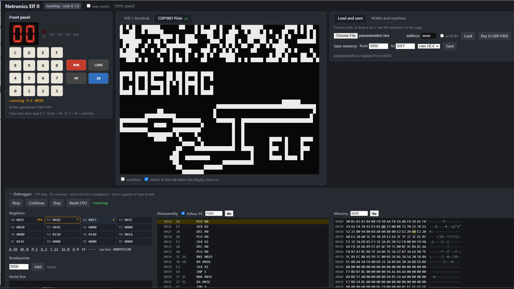

# RCA 1802 / Netronics Elf II



An RCA CDP1802 (COSMAC) emulator written in Rust, a cross-assembler, a small
machine-oriented language that compiles to 1802 assembly, and a browser front end.

## Try it in your browser (nothing to install)

**https://kosmjon.github.io/rca1802/**

The emulator runs entirely in your browser as WebAssembly. It models a Netronics
Elf II with a front panel and hex keypad, the CDP1861 Pixie video chip, and a
VID-1 serial terminal, and includes a debugger.

- Load a `.hex` or `.bin` file (or drop it on the page) and press RUN.
- Try a bundled program: add `?load=pixie64x128.hex&run=1` to the page address.
  Other bundled programs: `pixie64x32.hex`, `serial_echo.hex`.
- Your machine state and any ROMs you load as ROM are kept in your browser
  (IndexedDB / localStorage) and resumed on your next visit. *Power cycle* starts fresh.
- Full instructions for the page: [`emulator/web/README.md`](emulator/web/README.md).

## What is in this repository

| Path | Contents |
|---|---|
| `emulator/crates/cdp1802` | CPU core (`no_std`, no machine knowledge) |
| `emulator/crates/elf2` | Elf II machine model: memory map, front panel, keypad, display, Pixie, serial |
| `emulator/crates/elf2-wasm` | WebAssembly bindings used by the web page |
| `emulator/crates/elf2-cli` | Command-line emulator |
| `emulator/crates/asm1802` | Cross-assembler (QELFEXE-style source dialect) |
| `emulator/crates/mol1802` | MOL1802: a machine-oriented language that transpiles to `asm1802` source ([guide](emulator/crates/mol1802/GUIDE.md)) |
| `emulator/web` | The static web front end (HTML, CSS, JS) |
| `sample-code/asm`, `sample-code/m18` | Example programs in assembly and MOL1802 |
| `docs/scans` | Scanned 1802 listings and their transcriptions |
| `cassette-loader` | Cassette-loading experiments and tools |

## Build and run locally

You need a recent stable Rust toolchain. For the web page you also need
[`wasm-pack`](https://rustwasm.github.io/wasm-pack/) and Python (for a local web server).

```
cd emulator
cargo test --workspace
```

### Web page

On Windows, run `run_emulator.bat` in the repository root. It builds the WebAssembly
module if `wasm-pack` is available, serves the page on http://127.0.0.1:1802/ and
opens it. By hand:

```
cd emulator
wasm-pack build crates/elf2-wasm --target web --release --out-dir ../../web/pkg
python -m http.server 1802 --bind 127.0.0.1 --directory web
```

A web server is required; browsers do not load WebAssembly or module workers from `file://`.

### Assemble a program

```
cd emulator
cargo run -p asm1802 -- ../sample-code/asm/disassembler.asm -l     # .hex and .lst
cargo run -p mol1802 -- ../sample-code/m18/disassembler.m18 --assemble
```

Each tool prints its options with `--help`.

### Run a program from the command line

```
cd emulator
cargo run -p elf2-cli -- --load program.hex --cycles 1000000 --screen
```

## Publishing the web page (GitHub Pages)

`.github/workflows/pages.yml` builds the WebAssembly module and publishes
`emulator/web` on every push to `main`. One-time setup in the GitHub repository:
**Settings → Pages → Build and deployment → Source: GitHub Actions**.
The site then appears at `https://<user>.github.io/<repo>/`. All paths in the page
are relative, so it works from that sub-folder.

## License

`MIT OR Apache-2.0`, as declared in `emulator/Cargo.toml`.
